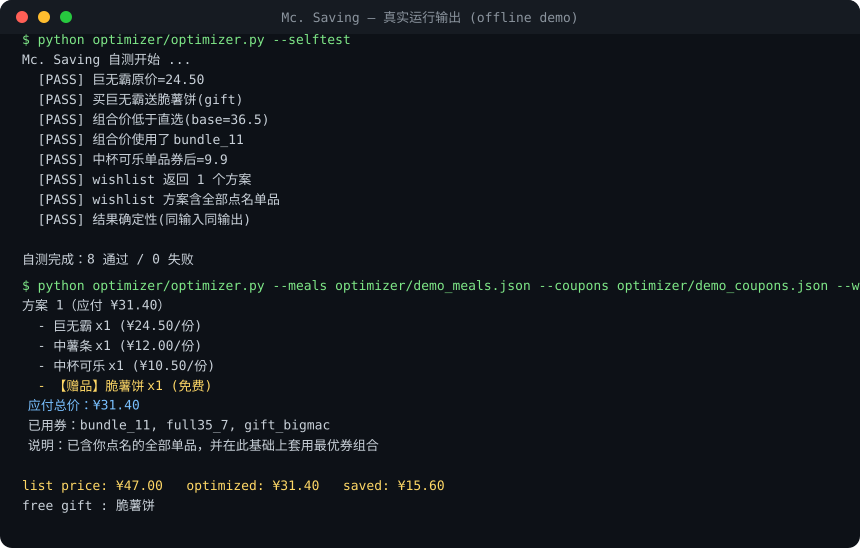
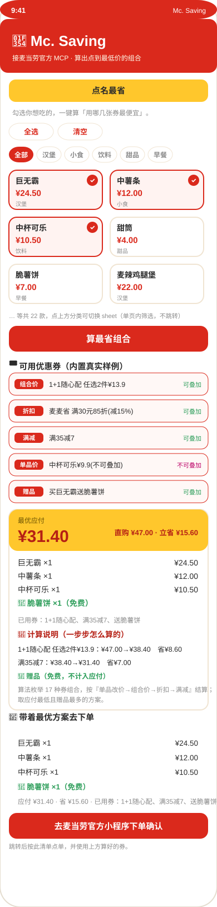

# Mc. Saving（McSaving）

> 取数交给 MCP，算术交给代码，表达交给 Agent。
> 让每一单都点到麦当劳的最低价。

<p align="center">
  
</p>

<p align="center">
  <a href="https://mc-saving.app.workbuddy.host/?sharecode=WTUKK3ABZT"><b>🌐 在线演示（H5 网页版）· 手机/微信直接打开</b></a><br>
  <sub>由 WorkBuddy 应用托管，长期有效 · 无需安装，点开即用</sub>
</p>

**它能替你省多少？** 实测：点"巨无霸 + 中薯条 + 中杯可乐"，直购 **¥47.00**，优化后 **¥31.40**，立省 **¥15.60**，还白拿一份脆薯饼。价格错一位数就是事故——所以算术交给确定性代码，不靠大模型心算。

**Mc. Saving**是参加「麦当劳程序员创意开发大赛」的开源 Skill：基于麦当劳官方 **MCP** 能力，帮你把"怎么点最便宜"算得清清楚楚。它拉取实时菜单与四路券池，用确定性优化器算出合规最低价组合，再用 `calculate-price` 核价，最后可以一键下单。

本项目由 **WorkBuddy** 辅助开发。

## 可视化界面（H5 + 微信小程序）

不想敲命令行？本项目配套两套**可直接交互**的可视化界面，底层共用同一套确定性优化器（与 Python 自测结果完全一致）：

- **H5 网页版**（`app/`）：手机浏览器直接打开，点选餐品 → 实时算最省组合，支持「点名最省」「预算内最值」两种模式。在微信里也能打开，适合分享冲 Star。🌐 在线体验：[mc-saving.app.workbuddy.host](https://mc-saving.app.workbuddy.host/?sharecode=WTUKK3ABZT)
- **微信小程序**（`miniprogram/`）：用微信开发者工具导入即可预览/发布，界面与 H5 一致。

<p align="center">
  
</p>

### 本地运行 H5
```bash
cd app
python3 -m http.server 8080
# 浏览器打开 http://localhost:8080
```

### 运行微信小程序
1. 微信开发者工具 → 导入项目 → 选择本仓库 `miniprogram/` 目录；
2. AppID 可先用「测试号」（`project.config.json` 已填 `touristappid`），正式发布再替换为你自己的 AppID；
3. 编译即可在模拟器看到界面，真机预览用微信扫二维码。

> 两套界面均使用 `shared/` 下同一份算法（`optimizer.js` + `sample_data.js`），内置真实样例数据，**纯前端、零依赖、无需 Token 即可体验完整交互**。

### 一键下单 · 跳转到官方小程序

算完最省组合后，交互界面会多出一块「🛒 带着最优方案去下单」：列出本单明细、应付、已用券，并提供「去麦当劳官方小程序下单确认」按钮，形成完整闭环。

- **H5 网页版**（`app/`）：点击后弹出下单清单（已自动复制到剪贴板），「打开小程序」会尝试拉起麦当劳官方小程序；非微信环境或演示环境会提示用微信搜索『麦当劳』小程序按清单点单。
- **微信小程序版**（`miniprogram/`）：通过 `wx.navigateToMiniProgram` 直接跳转到麦当劳官方小程序（需在 `app.json` 的 `navigateToMiniProgramAppIdList` 中登记官方 AppID）。

> 跳转目标为麦当劳官方小程序（金拱门(中国)有限公司）。受微信平台限制，跨小程序跳转需**互相配置白名单**：正式使用前，请把 `app/app.js` 与 `miniprogram/pages/index/index.js` 顶部的 `MCD_OFFICIAL_APPID` 替换为官方真实 AppID，并在各自后台完成互相调用配置；H5 侧若要做到「自动拉起」，可在同文件填入由后端生成的微信签名 URL Scheme（`MCD_URL_SCHEME`）。仓库默认值均为占位符，仅用于演示交互闭环。

---

## 它能做什么

- **点名模式**："我要巨无霸+薯条+可乐，怎么点最便宜？" → 在包含你点名单品的前提下，套用最优券组合。
- **预算模式**："30 块在麦当劳能吃什么？" → 在预算内筛出最值（省得最多）的搭配。
- **省钱解释**：讲清省了多少、用了哪张券、为什么这么搭。
- **闭环核价**：下单前用麦当劳 MCP 的 `calculate-price` 复核，确保"说的价 = 收银台的价"。

## 为什么不用大模型直接算

价格计算是典型的组合爆炸：菜单几十项、券十几张、每张券规则不同（单品改价 / 折扣 / 满减 / 组合价 / 赠品），还要算"为凑满减加购划不划算"。大模型做多步算术和约束推理错误率很高，而价格错一位数就是事故。所以本项目把算术彻底从模型里拿出来，做成纯标准库、零依赖、**可测试、可复现、可断言**的确定性优化器。

## 安装与使用

### 1. 获取麦当劳 MCP Token（免费）
打开 https://open.mcd.cn/mcp ，用手机号验证登录 → 右上角「控制台」→「激活」→ 复制 Token。

### 2. 接入 WorkBuddy（推荐）
左侧【专家·技能·连接器】→【连接器】→【自定义连接器】→【配置 MCP】，粘贴：
```json
{
  "mcpServers": {
    "mcd-mcp": {
      "type": "streamablehttp",
      "url": "https://mcp.mcd.cn",
      "headers": { "Authorization": "Bearer 你的MCP_Token" }
    }
  }
}
```
启用 `mcd-mcp` 后即可在对话框直接说需求。

### 3. 离线运行优化器（无需 Token）
仓库已附带离线样例 `optimizer/demo_meals.json` 与 `optimizer/demo_coupons.json`，可直接复现上面的截图：
```bash
cd optimizer
python optimizer.py --selftest                                                              # 10 项自测（截图上半部分）
python optimizer.py --meals demo_meals.json --coupons demo_coupons.json --wishlist "big_mac,mid_fries,mid_coke"   # 点名最省
python optimizer.py --meals demo_meals.json --coupons demo_coupons.json --budget 30          # 预算内最值
```
> 真实使用时，`meals.json` 来自 MCP `query-meals`（需 `storeCode`），`coupons.json` 来自 `auto-bind-coupons` / `available-coupons` / `query-my-coupons` / `query-store-coupons` 四路合并（前三路无需 `storeCode`）。

### 4. 真实 MCP 端到端验证（已实测）
`optimizer/mcp_client.py` 是最小化的麦当劳 MCP 客户端（纯标准库，读环境变量 `MCD_MCP_TOKEN`），`optimizer/live_proof.py` 用它**真实连接 `mcd-mcp`**：

- 拉取了真实卡包券（`query-my-coupons`）与可领券（`available-coupons`）——例如实测返回「11.9元麦辣鸡腿堡」「19.9元王牌炸鸡任选2」「免费脆薯饼」；
- 把真实券语义（单品改价 / 组合价 / 赠品）1:1 映射进优化器，跑出真实省钱方案；
- 过程中还发现并修复了一处 `free_gift` 赠品分支的 bug（已在 `optimizer.py` 修正，自测回归覆盖）。

完整输出见 **[`LIVE_DEMO.md`](./LIVE_DEMO.md)**（为该次真实调用的快照，券含"今日到期"等时效信息，仅供参考）。

## 目标用户

- 想"吃得饱又吃得省"的普通消费者
- 选择困难、不想研究菜单比价的人
- 减脂/控卡期需要按营养约束点餐的人

## 项目结构

```
mc-saving/
├── SKILL.md                    # WorkBuddy Skill 定义
├── README.md                   # 本文件
├── CONTEST_DECLARATION.md      # 参赛声明（官方原文，不可改）
├── MCP_INTEGRATION.md          # MCP 接入与工具说明（含实测响应格式）
├── mcp-config.example.json     # 脱敏 MCP 配置（仅占位符）
├── workbuddy.md                # WorkBuddy 专项奖励所需开发上下文
├── LIVE_DEMO.md                # 真实 MCP 取数演示快照（实测证据）
├── demo_screenshot.svg         # 真实跑通终端截图（README 展示用）
├── app_preview.svg             # H5/小程序 界面预览图（README 展示用）
├── make_screenshot.py          # 生成终端截图的脚本（零依赖）
├── make_app_preview.py         # 生成界面预览图的脚本（零依赖）
├── shared/                     # 跨端共享算法（H5 与小程序共用，零依赖）
│   ├── optimizer.js            # 确定性价格优化器（JS 移植，与 Python 行为一致）
│   └── sample_data.js          # 内置真实样例菜单与券
├── app/                        # H5 网页版（可视化界面）
│   ├── index.html
│   ├── app.css
│   └── app.js
├── miniprogram/                # 微信小程序工程（可视化界面）
│   ├── app.js / app.json / app.wxss
│   ├── project.config.json     # 已填测试号 touristappid
│   ├── sitemap.json
│   ├── utils/                  # 复制自 shared/ 的算法
│   └── pages/index/            # 首页四件套（wxml/wxss/js/json）
└── optimizer/
    ├── optimizer.py            # 确定性价格优化器（核心，Python 版）
    ├── sample_data.py          # 离线样例菜单与券
    ├── demo_meals.json         # 离线样例菜单（截图演示用 fixtures）
    ├── demo_coupons.json       # 离线样例券池（截图演示用 fixtures）
    ├── selftest.py             # 10 项自测
    ├── mcp_client.py           # 最小化麦当劳 MCP 客户端（纯标准库）
    └── live_proof.py           # 真实取数 → 优化器 端到端演示
```

## 声明

本项目为大赛参赛作品，由参赛者独立开发，**非麦当劳官方产品**。餐品信息、价格及供应状态以麦当劳官方渠道实时结果为准。详见 `CONTEST_DECLARATION.md`。
